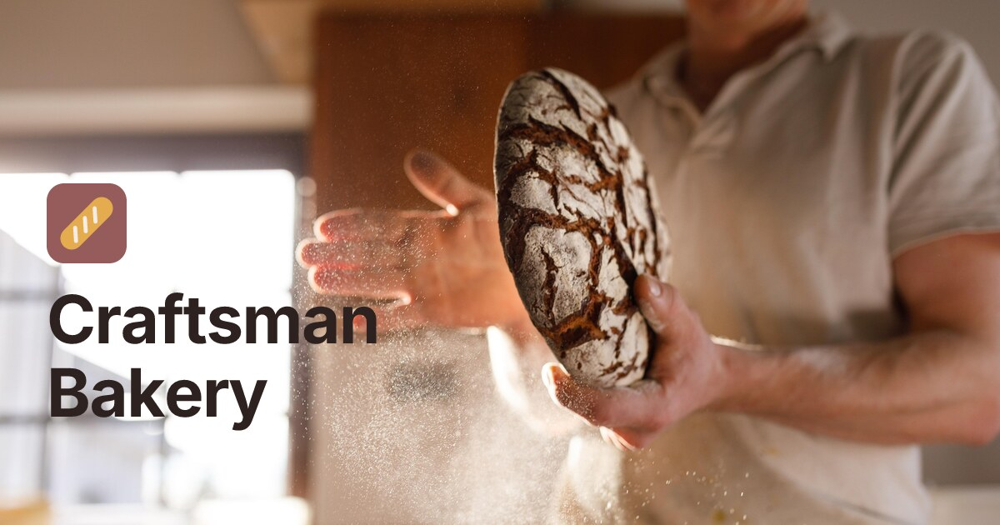

# Craftsman Bakery



Bread and pastry reservations for a small bakery.

Customers reserve for pickup.\
Staff get the bake count, the pickup list and a capacity suggestion from
[Clef](https://blog.cloudflare.com/clef-decision-models/), Cloudflare's small decision model.

**[Live demo](https://craftsman-bakery.quantum-amplitude.tech)**: the staff sign-in page shows
the demo account.\
Simulated customers reserve every night, so there is always a day to look at.

## What it does

- **Customers** reserve for tomorrow, until 18:00 the day before.\
  All or nothing; a 4-character code cancels it.
- **Staff** see today, tomorrow and the day after.\
  Bake count, capacity to edit, pickup list by code.
- **Clef** compares each product with recent same weekdays and what is reserved.\
  It suggests a capacity; staff decide.

## Architecture

```text
Browser ──► craftsman-bakery-web ──service binding──► craftsman-bakery-api ──Hyperdrive──► Neon Postgres
            Next.js 16 on OpenNext                    Hono, oRPC, Drizzle  ──Workers AI──► Clef
```

- The browser talks only to Next.js: prerendered shells with streamed server components, Server
  Actions for every write, and the fully static pages served from Workers static assets.
- The API owns the rules (cutoff, capacity, codes) behind an oRPC contract shared through
  `packages/contracts`. Commands and queries are separate; queries read through a cached
  Hyperdrive, commands and staff reads through an uncached one.

| Layer | Choice |
|---|---|
| Monorepo | Bun workspaces, Turbo, Biome, TypeScript |
| Web | Next.js 16 (Cache Components, React Compiler), React 19, Tailwind 4, shadcn on Base UI |
| API | Hono, oRPC with Zod, Drizzle on `pg` |
| Auth | Better Auth for staff, Turnstile on sign-in |
| Data | Neon Postgres through Hyperdrive |
| AI | Clef on Workers AI |
| Hosting | Cloudflare Workers: the web through OpenNext, the API behind a service binding |
| Tests | Bun test; the API against a real Postgres |

## Repository

```text
apps/web             Next.js app: customer pages and the staff day
apps/api             API Worker: contract handlers, commands, queries, Clef adapter, migrations
packages/contracts   oRPC contract, Zod schemas, calendar helpers
```


## Development

```zsh
bun install
bun run db:up        # Postgres 19 in Podman: development on 5435, test on 5436
bun run db:migrate
cp apps/api/wrangler.example.jsonc apps/api/wrangler.jsonc
cp apps/web/wrangler.example.jsonc apps/web/wrangler.jsonc
bun run dev          # web on 3847, API on 3848
```

The database starts empty: add products, a staff user and either bake history or capacities before
the pages have anything to show. In development Clef runs through the real Workers AI binding,
which needs a Wrangler login.

## Checks

```zsh
bun run lint:fix
bun run typecheck
bun run test
```
